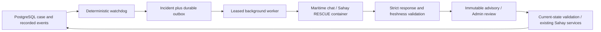

# Sahay RESCUE — Emergency Recovery & Resilience Agent

This is an independent, opt-in, asynchronous integration for **synthetic cases**.
It preserves the four dashboards and the existing Gemini/deterministic dispatch,
hospital matching, specialist, OSRM and handoff services. The initial checkout had
none of the reported Maritime files or advisory migrations; these were added,
without fetching, merging or replacing local work.

## Architecture and data flow



No cloud request is awaited by SOS creation, auto-dispatch, hospital matching or
routing. Each worker pass scans persisted synthetic cases and claims at most one
due job. Timers only wake the worker: the queue, retry deadlines, leases, attempt
limits, request budget and circuit state all live in PostgreSQL.

### Incident model

| Category | Deterministic condition | Evidence/episode anchor |
| --- | --- | --- |
| AMBULANCE_OFFER_TIMEOUT | Offer deadline elapsed, or recorded expired offer still unassigned | Latest offer/expiry event |
| AMBULANCE_REJECTION_CASCADE | Configured rejection count within the configured window; still awaiting a vehicle | Latest rejection event |
| HOSPITAL_REFERRAL_FAILURE | Latest unconfirmed referral rejected or pending/withdrawn beyond threshold | Referral ID and recorded status/time |
| ETA_DETERIORATION | Current ETA exceeds a persisted baseline for this transport phase by the configured number of minutes | Baseline event and phase |
| STALE_AMBULANCE_GPS | Active travel with last recorded position older than the threshold | Last ping timestamp |
| HANDOFF_DELAY | Recorded hospital arrival has exceeded the handoff threshold | Arrival event |

Keys include case ID, category, episode anchor and relevant operational context.
GPS updates alone do not create repeated incidents while the same failure persists.
The watchdog records a `rescue:detected` event. Evidence contains that event and a
small allowlist of prior operational event IDs/types/times. Baselines are recorded
once per observed travelling phase. Missing historical ETA baselines are not invented.

Lifecycle: `detected` → `investigating` → `recommendation_ready` →
`admin_review_required` → `resolved`, `superseded` or `failed`.
Recommendation-ready and review-required transitions are retained in the audit;
the current state becomes review-required after successful processing. Closing a
condition does not by itself assert successful dispatch or care. Resolved records
cannot be reopened by a delayed reply or dismissal. Selected cases with incidents
receive one separate, immutable post-handoff analysis job.

### Queue and response integrity

- Per-case row locks serialize detection and episode creation. Unique episode
  keys and unique incident/job-kind pairs suppress duplicates.
- PostgreSQL `FOR UPDATE SKIP LOCKED`, a lease token and an eligibility-checked
  update prevent concurrent ownership. UTC comparisons match Prisma timestamps.
  Expired leases are recoverable; old tokens cannot persist results.
- Request timestamps and breaker state are shared across application instances.
  Three consecutive failures open the breaker for 30 seconds; permanent HTTP
  configuration/auth/budget failures pause connectivity for five minutes.
- Retry delay doubles from one second to a maximum of 60 seconds and respects a
  longer Retry-After value. Five attempts are the default limit. HTTP 400/401/402/
  403/404 stop the affected job rather than blindly retrying it.
- Responses must echo incident ID, opaque case alias, input case version and
  category. Every cited ID must belong to the persisted evidence envelope.
  Unknown fields, unsafe playbooks, missing references, invalid JSON and invalid
  timestamps are rejected. Confidence is expressed as uncertainty text, not a
  calibrated numerical probability.
- Freshness is based on the current incident predicate and relevant resource/
  transport context. Unrelated case-version increments do not invalidate an
  otherwise-current snapshot. Admin execution separately requires the exact
  current case version and revalidates the current predicate.
- A job has at most one immutable advisory. Remote calls are at-least-once after
  uncertain delivery/restart; provider-side deduplication is not claimed. A
  repeated remote call cannot directly mutate Sahay state.

## Privacy and recovery boundaries

Only non-production cases belonging to the existing synthetic patient account
are eligible. Envelope validation runs **before transmission**, including a strict
field/type allowlist. No names, addresses, coordinates, contact details, symptoms,
clinical notes, diagnoses, treatment logs or raw database objects are sent. The
agent has no database/network tools and receives no Sahay credentials.

| Advisory code | Permitted reviewed behavior |
| --- | --- |
| RETRY_ELIGIBLE_AMBULANCE | Request another primary-engine pass for an unassigned pending case; existing eligibility/reservation checks remain authoritative. |
| ESCALATE_DRIVER_NONRESPONSE | Record the Admin-reviewed escalation in case history. |
| REASSESS_HOSPITAL_OPTIONS | Request the primary engine to reassess an unconfirmed destination. A confirmed destination still requires the established replacement/acceptance workflow. |
| REQUEST_ROUTE_REEVALUATION | Recheck the route through the existing OSRM/fallback service using server-held coordinates and current travel/GPS state. It does not promise a new ETA or destination. |
| FLAG_GPS_COMMUNICATION_FAILURE | Record the communication concern. In gated simulation only, call the mock-drive recovery service to restore simulated reports. No real GPS position is fabricated. |
| ESCALATE_ADMIN_REVIEW | Record the reviewed escalation; no dispatch or clinical transition. |
| GENERATE_INCIDENT_SUMMARY | Acknowledge the evidence-backed analysis; no operational transition. |

The agent never executes text, SQL, URLs or arbitrary instructions. There is no
automatic destination switch, dispatch override, bed confirmation or treatment.
Admin and patient API authorization are tested. Incident/history endpoints are
Admin-only; simulation interruption requires the assigned driver and explicit
development configuration.

## Actual configuration

Backend `.env` settings (defaults are shown in `.env.example`):

```dotenv
MARITIME_ENABLED=false
MARITIME_API_KEY=
MARITIME_AGENT_ID=
MARITIME_API_BASE_URL=https://api.maritime.sh
MARITIME_TIMEOUT_MS=15000
MARITIME_REQUESTS_PER_MINUTE=6
MARITIME_POLL_MS=5000
MARITIME_MAX_ATTEMPTS=5
RESCUE_OFFER_TIMEOUT_MS=120000
RESCUE_REJECTION_COUNT=3
RESCUE_REJECTION_WINDOW_MS=300000
RESCUE_REFERRAL_TIMEOUT_MS=120000
RESCUE_ETA_INCREASE_MINUTES=5
RESCUE_GPS_STALE_MS=90000
RESCUE_HANDOFF_DELAY_MS=300000
RESCUE_SIMULATION_CONTROLS=false
```

The HTTP client sends server-side Bearer authentication and only the documented
`message` body field to `POST /api/agents/{agent_id}/chat`; it parses the documented
`response` string. No undocumented idempotency or mutation parameters are assumed.
[Maritime REST API](https://maritime.sh/docs/api)

The container at `agents/sahay-rescue` binds the injected PORT, serves a fast
`GET /health` and accepts `POST /chat`. It returns a response string within the
platform's 30-second contract; its model request deadline is 20 seconds. Its
policy is versioned in `instructions.md` and its validator is shared with the
backend. [Custom-container contract](https://maritime.sh/docs/frameworks/custom)

Container configuration requires OPENAI_BASE_URL, OPENAI_API_KEY and RESCUE_MODEL.
A custom Maritime container needs explicit model configuration; Maritime LLM can
provide the two OpenAI-compatible connection variables when enabled. Model calls
consume provider credits. [Maritime LLM](https://maritime.sh/docs/llm)

For an approved deployment, build from the repository root:

```powershell
docker build -f agents/sahay-rescue/Dockerfile -t YOUR_REGISTRY/sahay-rescue:v1 .
```

The Docker context excludes local credentials, database files and dependencies.
Choose a registry/image you own and confirm the model/budget before creating a
cloud resource. An appropriate documented create payload, **not executed**, is:

```json
{"name":"Sahay RESCUE","framework":"custom","imageName":"YOUR_REGISTRY/sahay-rescue:v1","useMaritimeLlm":true}
```

Set RESCUE_MODEL to a model actually available to that agent/account. No real
agent ID, live credentials or approved paid cloud resource existed during this
implementation. The Docker image was not built on this laptop because Docker
is unavailable. The actual Node health/chat server was exercised with an
injected local model response; this is not a cloud deployment claim.

## Local mock and repeatable browser demonstration

Start a local fixture endpoint in a separate terminal:

```powershell
cd backend
node scripts/mock-maritime.cjs
```

For an isolated synthetic test API, set the following environment values before
starting it. Use a separate migrated and seeded local database; do not point a
second worker at the development database.

```dotenv
NODE_ENV=development
MARITIME_ENABLED=true
MARITIME_API_KEY=mock-maritime-key
MARITIME_AGENT_ID=local-rescue
MARITIME_API_BASE_URL=http://127.0.0.1:5090
MARITIME_POLL_MS=1000
RESCUE_GPS_STALE_MS=5000
RESCUE_SIMULATION_CONTROLS=true
```

1. As Patient, confirm a public manual pickup, choose the cardiac condition and
   submit a synthetic SOS. The configured Gemini/deterministic path continues.
2. As Ramesh Driver, accept the offered ambulance and start its mock route.
3. Click **Simulate GPS interruption**. The backend stops position reports;
   Patient/Driver maps hold the last known position and identify the interruption.
4. After the configured threshold, open Admin's RESCUE panel. Inspect the
   STALE_AMBULANCE_GPS evidence and explicitly labelled mock recommendation.
5. Approve validated recovery. The server rechecks current state and uses the
   simulation service to restore GPS. No vehicle or hospital is reassigned.
6. Accept the hospital referral, confirm patient pickup, start the hospital route
   and record hospital handoff through the normal roles.
7. In Admin, include resolved history and inspect the post-incident analysis.
8. Repeat with MARITIME_ENABLED=false and simulation controls false. Primary
   emergency workflow must still complete; there must be no new cloud requests.

The fixture is deterministic and labelled `mock_maritime`, never live Maritime AI.
The normal app remains at port 5174 with Maritime disabled by default. Temporary
browser-test services used ports 5002, 5175 and 5090; those are separate from the
normal app and should be stopped after verification.

## Migrations and tests

Migration `20261115000600_maritime_rescue` adds MaritimeIncident, MaritimeJob,
MaritimeAdvisory and MaritimeRuntime. It adds no destructive data transformation.
Case history links are retained; application workflows never delete incidents.
Trip deletion cascades its synthetic intelligence records only when a case itself
is explicitly deleted, such as disposable test cleanup.

```powershell
npm.cmd run db:generate --prefix backend
npm.cmd run db:migrate --prefix backend
cd backend
node node_modules/prisma/build/index.js validate
cd ..
npm.cmd test --prefix backend
npm.cmd test --prefix frontend
npm.cmd run build --prefix frontend
git diff --check
```

The default test runner creates a random local `_test` database, applies all
migrations, seeds fixtures, runs tests and drops only that newly created database.
An explicit TEST_DATABASE_URL is never dropped. Existing development and browser
test histories are preserved. Migration/seed failures and failed tests remain
failures; they are not counted as skipped passes.

See the delivery report for actual test counts, browser case IDs, performance
measurements, screenshots and live-connectivity limitations.
